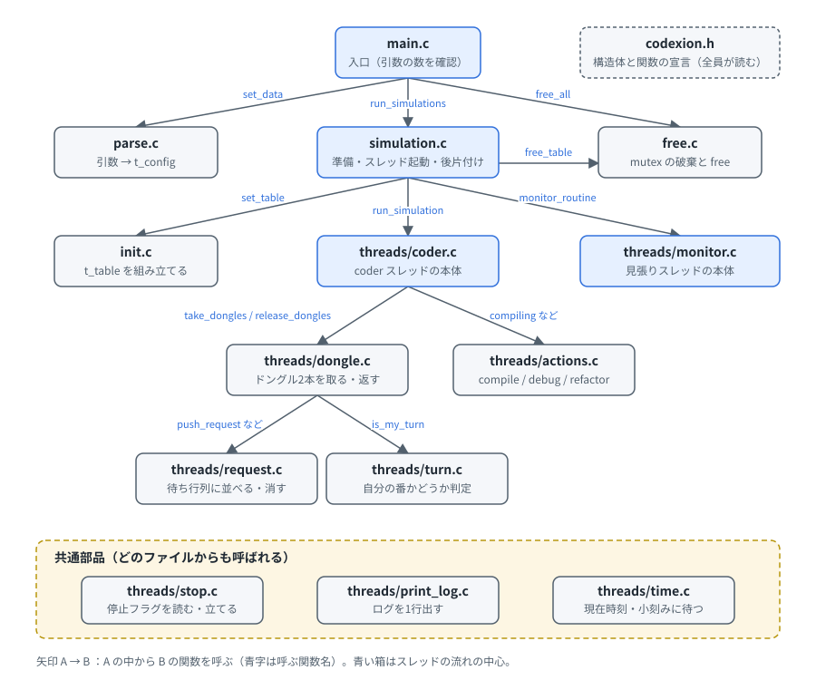

# 00. 全体像

この `guide/` は、Codexion をこれから自分で作る人のための手引きである。
完成版のソース（`codes/`）が「どのファイルに・何を・どの順で」書いているかを説明する。

課題のルールそのものは `codes/README_ja.md` と `subject/` を先に読むこと。

## 読む順番

| ファイル | 内容 | 対応するソース |
|---|---|---|
| [00_overview.md](00_overview.md) | 全体像（このファイル） | すべて |
| [01_parse_init.md](01_parse_init.md) | 引数チェックと構造体の準備 | `main.c` `parse.c` `init.c` `free.c` `codexion.h` |
| [02_threads.md](02_threads.md) | スレッドの起動から終了まで | `simulation.c` `threads/coder.c` `threads/monitor.c` `threads/actions.c` |
| [03_dongle_scheduler.md](03_dongle_scheduler.md) | ドングルの取り合いと fifo / edf | `threads/dongle.c` `threads/request.c` `threads/turn.c` |
| [04_stop_log_time.md](04_stop_log_time.md) | 停止フラグ・ログ・時間・mutex の順番 | `threads/stop.c` `threads/print_log.c` `threads/time.c` |
| [05_build_order.md](05_build_order.md) | 実装する順番と確認コマンド | すべて |

## プログラムの目的（1行で）

N 人の coder（スレッド）が円卓を囲み、隣と共有するドングル2本をそろえてコンパイルする。
燃え尽きる人が出るか、全員が規定回数コンパイルしたら止まる。

## ファイルと呼び出しの関係



- `main.c` が入口。引数を `parse.c` で読み、`simulation.c` に渡す。
- `simulation.c` が構造体を作り（`init.c`）、スレッドを起動し、終わったら片付ける（`free.c`）。
- スレッドは2種類ある。
  - **coder スレッド**（N 本）：`threads/coder.c` の `run_simulation` が本体。
  - **monitor スレッド**（1 本）：`threads/monitor.c` の `monitor_routine` が本体。燃え尽きと終了条件を見張る。
- `threads/stop.c`・`threads/print_log.c`・`threads/time.c` は、どこからでも呼ばれる共通部品。

## 実行のしかた

```sh
cd codes
make
./codexion 4 800 200 200 200 5 0 fifo
```

引数は8個で、順番は次のとおり（すべて 0 以上 INT_MAX 以下の整数。最後だけ文字列）。

| 番号 | 名前 | 意味 | 例 |
|---|---|---|---|
| 1 | `number_of_coders` | coder の人数（1 以上） | `4` |
| 2 | `time_to_burnout` | この ms 以内に次のコンパイルを始めないと燃え尽きる | `800` |
| 3 | `time_to_compile` | コンパイルにかかる ms | `200` |
| 4 | `time_to_debug` | デバッグにかかる ms | `200` |
| 5 | `time_to_refactor` | リファクタリングにかかる ms | `200` |
| 6 | `number_of_compiles_required` | 全員がこの回数コンパイルしたら終了 | `5` |
| 7 | `dongle_cooldown` | 返されたドングルを再び取れるまでの ms | `0` |
| 8 | `scheduler` | `fifo` か `edf` | `fifo` |

出力は1行ずつ `<開始からの経過ms> <coder番号> <状態>` の形になる。

```text
0 1 has taken a dongle
0 1 has taken a dongle
0 1 is compiling
200 1 is debugging
```

## あわせて読む（既存の図解）

`design/` には完成版の動きを図にした HTML がある。この手引きと合わせて読むとよい。

- [../design/codexion_rules.html](../design/codexion_rules.html)：課題ルールの図解
- [../design/design_Codexion.html](../design/design_Codexion.html)：設計書（やさしい版）
- [../design/struct_relations.html](../design/struct_relations.html)：構造体の関係図
- [../design/struct_timeline.html](../design/struct_timeline.html)：構造体の時系列
- [../design/mutex_figures.html](../design/mutex_figures.html)：mutex の図解
- [../design/stop_flag_figures.html](../design/stop_flag_figures.html)：停止フラグの図解
