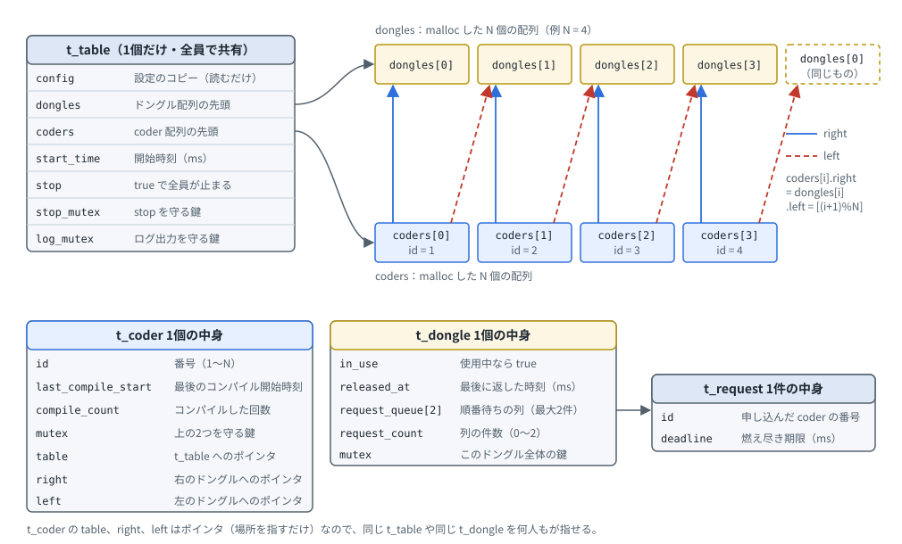
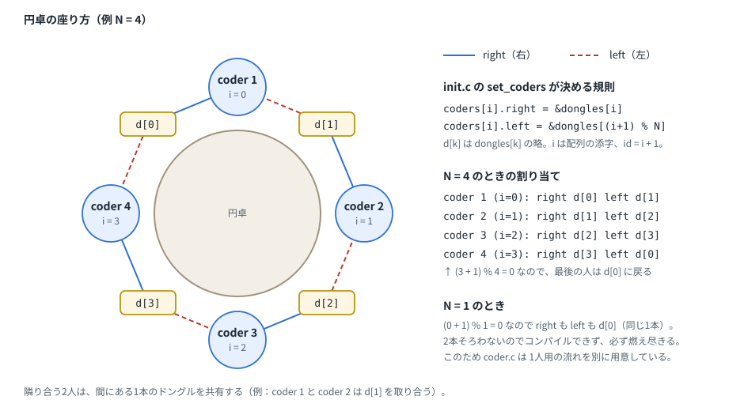

# 01. 引数チェックと構造体の準備

対象ファイル：`codes/codexion.h` `codes/main.c` `codes/parse.c` `codes/init.c` `codes/free.c`

ここではスレッドはまだ1本も動いていない。main スレッドだけで「設定を読む → 構造体を作る」までを行う。

## 1. 構造体（codexion.h）

構造体は5つある。

| 構造体 | 個数 | 役割 |
|---|---|---|
| `t_config` | 1 | 8個の引数を入れる箱。作ったあとは読むだけ |
| `t_table` | 1 | 全員で共有する円卓。設定・配列・停止フラグ・鍵を持つ |
| `t_coder` | N | coder 1人分。スレッド1本が1つを担当する |
| `t_dongle` | N | ドングル1本分。両隣の2人が共有する |
| `t_request` | ドングル1本につき最大2 | 「このドングルを使いたい」という申し込み1件 |



ポイント：

- `t_table` は `dongles` と `coders` の配列の先頭を持つ。配列は `malloc` で N 個ずつ作る。
- `t_coder` の `right` と `left` はドングルを指すポインタ。隣の人と同じドングルを指すことで「共有」を表す。
- `t_coder` の `table` は円卓を指すポインタ。スレッドには `t_coder *` だけを渡すので、ここから設定や停止フラグにたどり着く。
- 時刻はすべて `long long` の ms（1970年からのミリ秒）。`int` だと桁があふれる。

### 各メンバが必要な理由

<details>
<summary>t_config：なぜこのメンバが必要か</summary>

| メンバ | 必要な理由（使う場所） |
|---|---|
| `number_of_coders` | 配列を何個作るか、ループを何回回すかを決める。`left` の計算 `(i + 1) % N` と、1人用の流れに分ける判定（`N == 1`）にも使う |
| `time_to_burnout` | monitor が燃え尽きを判定する（`is_burned_out`）。edf の期限 `deadline` の計算にも使う |
| `time_to_compile` | `compiling` で待つ時間。fifo で偶数番が最初に待つ時間（`/ 2`）にも使う |
| `time_to_debug` | `debugging` で待つ時間 |
| `time_to_refactor` | `refactoring` で待つ時間 |
| `number_of_compiles_required` | 全員が終わったかの判定（`is_all_compiled`）。0 なら何もせず終了する |
| `dongle_cooldown` | 返されたドングルをまだ取れないかの判定（`is_cooldown`） |
| `scheduler` | 列の並べ方を変える（`push_request`）。fifo のときだけ偶数番を最初に待たせる（`coder.c`） |

</details>

<details>
<summary>t_request：なぜこのメンバが必要か</summary>

| メンバ | 必要な理由（使う場所） |
|---|---|
| `id` | 列の先頭が自分かを確かめる（`is_my_turn`）。edf で期限が同じとき、奇数番・小さい番号を先にする比較にも使う |
| `deadline` | edf で「期限が早い方を先頭へ」並べるための値。申し込んだ時点で計算して入れておくので、比べるときに計算し直さなくてよい |

</details>

<details>
<summary>t_dongle：なぜこのメンバが必要か</summary>

| メンバ | 必要な理由（使う場所） |
|---|---|
| `in_use` | 取った人は列から消える（`remove_request`）ので、列を見ただけでは「今だれかが使っている」と分からない。そのため使用中かどうかを別に持つ |
| `released_at` | クールダウンの計算「今の時刻 − `released_at`」に使う。返すたびに `release_a_dongle` が書く |
| `request_queue[2]` | 次にだれが取るかを決める順番待ちの列。1本を使うのは両隣の2人だけなので、2件で足りる |
| `request_count` | 配列の中身だけでは、何件入っているか（空かどうか）が分からない。次に入れる位置、空かどうかの判定、消したあとの件数に使う |
| `mutex` | 両隣の2人が同時に読み書きするので、鍵で守る |

</details>

<details>
<summary>t_coder：なぜこのメンバが必要か</summary>

| メンバ | 必要な理由（使う場所） |
|---|---|
| `id` | ログに出す番号。申し込みの `id`、fifo の偶数・奇数の判定にも使う |
| `last_compile_start` | 燃え尽き判定（monitor）と、edf の期限の計算（`make_request`）に使う |
| `compile_count` | 全員が規定回数に達したかの判定（`is_all_compiled`）に使う |
| `mutex` | 上の2つは本人が書いて monitor が読むので、同時に触らないように守る |
| `table` | スレッドに渡せる引数は1つだけ（`t_coder *`）。ここから設定・`stop`・`log_mutex`・`start_time` にたどり着く |
| `right` / `left` | 自分が使う2本を最初に決めておけば、毎回添字を計算しなくてよい。隣の人と同じドングルを指すことで共有を表す |

</details>

<details>
<summary>t_table：なぜこのメンバが必要か</summary>

| メンバ | 必要な理由（使う場所） |
|---|---|
| `config` | 全スレッドが設定を読む。最初にコピーしたあとは書きかえないので、鍵はいらない |
| `dongles` | ドングル配列を作る（`set_dongles`）・壊す（`free_table`）ために、配列の先頭を覚えておく |
| `coders` | monitor が全員を見回るため、また最後に解放するために、配列の先頭を覚えておく |
| `start_time` | ログの時刻は「開始からの経過 ms」なので、引き算の基準として使う |
| `stop` | 全員に「止まれ」と伝える合図。monitor やエラー処理が true にする |
| `stop_mutex` | `stop` は複数のスレッドが同時に読み書きするので、鍵で守る |
| `log_mutex` | 2つのスレッドの出力が1行の中で混ざらないように守る。burned out のあとに何も出さないためにも使う |

</details>

## 2. 引数を読む（main.c → parse.c）

`main` は次の順で動く。

1. `argc != 9` ならエラーを出して終了（引数8個＋プログラム名）。
2. `set_data(argv)` で `t_config` を作る。失敗したら `NULL` が返るので終了。
3. `run_simulations(*data)` を呼ぶ（02 で説明）。
4. 最後に `free_all(2, data, data->scheduler)` で2つの `malloc` を解放する。

`set_data` のチェック内容：

| チェック | 関数 | エラーメッセージ |
|---|---|---|
| 8番目が `fifo` か `edf` か | `is_scheduler` | `Error: scheduler must be fifo or edf` |
| 空文字でないか | `set_num` | `Error: argument is empty` |
| 数字以外がないか（`-` や `+` も不可） | `set_num` | `Error: argument is not digit` |
| INT_MAX を超えないか | `set_num` | `Error: argument is too large` |
| 人数が 0 でないか | `is_num_of_corders_positive` | `Error: number_of_coders must be > 0` |

`set_num` は1つの関数で `int` と `long long` の両方に対応する。
`num_int` が `NULL` でなければ `int` に、`NULL` なら `long long` に結果を入れる。

あふれ（オーバーフロー）の確認は、掛け算をする「前」に行う。

```c
if (result > (INT_MAX - (str[i] - '0')) / 10)
    /* result * 10 + digit が INT_MAX を超える */
```

## 3. 構造体を組み立てる（init.c）

`set_table` が `t_table` を `malloc` し、次の順で中身を埋める。

1. `config` をコピー、`stop = false`
2. `stop_mutex` と `log_mutex` を初期化
3. `set_dongles`：ドングル N 個を作る（`in_use = false`、`released_at = 0`、列は空、mutex 初期化）
4. `set_coders`：coder N 人を作る（`id = i + 1`、回数 0、`table`・`right`・`left` を設定、mutex 初期化）

座席の決め方が一番大事なので、図で確認しておく。



```c
coders[i].right = &(table->dongles[i]);
coders[i].left = &(table->dongles[(i + 1) % number_of_coders]);
```

`% number_of_coders`（N で割った余り）を使うので、最後の人の left は `dongles[0]` に戻り、円がつながる。

## 4. 失敗したときの片付け（free.c）

途中で `malloc` や `pthread_mutex_init` が失敗したら、それまでに作ったものだけを片付けて `false` を返す。

| 関数 | すること |
|---|---|
| `free_all(count, ...)` | 渡したポインタを `count` 個まとめて `free` |
| `destroy_dongle_mutexes(dongles, count)` | 先頭から `count` 個のドングルの mutex を破棄 |
| `destroy_coder_mutexes(coders, count)` | 先頭から `count` 人の coder の mutex を破棄 |
| `destroy_table_mutexes(table)` | `stop_mutex` と `log_mutex` を破棄 |
| `free_table(table)` | 上の3つを全部行い、配列と `table` を `free` |

例：`set_dongles` が3個目（`i = 2`）の mutex 初期化で失敗したら、`destroy_dongle_mutexes(dongles, 2)` で作れた2個だけを破棄する。
「作った数だけ壊す」ために `count` を引数で渡している。
