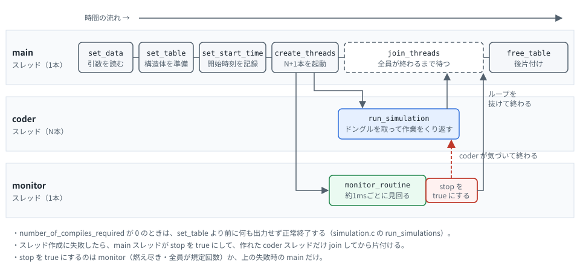
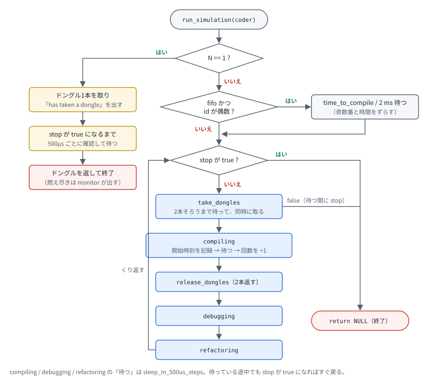

# 02. スレッドの起動から終了まで

対象ファイル：`codes/simulation.c` `codes/threads/coder.c` `codes/threads/monitor.c` `codes/threads/actions.c`

## 1. 全体の時間の流れ（simulation.c）



`run_simulations(config)` の流れ：

1. `number_of_compiles_required == 0` なら、何もせず `true` を返す（1回もコンパイルしなくてよいので即終了）。
2. `set_table` で構造体を作る（01 を参照）。
3. `pthread_t` を N 個入れる配列を `malloc` する。
4. `set_start_time`：開始時刻を `table->start_time` に記録し、全員の `last_compile_start` も同じ時刻にする。
   これで「開始から `time_to_burnout` ms 以内に最初のコンパイルを始める」というルールになる。
5. `create_threads`：coder スレッドを N 本作り、そのあと monitor スレッドを1本作る。
   - `pthread_create` で作られたスレッドは、**作られたその瞬間から動き始める**。
     main スレッドが全員を作り終えるのを待ってはくれない。
   - たとえば N = 4 なら、`coders[0]`（coder 1）は `coders[1]` が作られる前に、もうドングルを取りに行っている。
   - 作る順番は coder 1 → coder 2 → … → coder N → monitor。monitor が一番最後になる。
   - 作るのが少し遅れても、燃え尽きの計算は手順4で決めた同じ開始時刻から数えるので、不公平にならない。
6. `join_threads`：main スレッドは、ここで全スレッドが終わるまで止まって待つ。
   - `pthread_join(t, NULL)` は「スレッド t が終わるまで、呼んだ側（main）を止める」関数である。
   - 待つ順番は coder 1 → … → coder N → monitor。
     先に終わっていたスレッドの join は、すぐに戻る。
   - スレッドが終わるのは `stop` が `true` になったときだけである。
     - monitor：燃え尽きを見つけるか、全員が規定回数に達したら `stop` を `true` にし、次の見回りの確認でループを抜けて終わる。
     - coder：`stop` が `true` になると、待ちの途中ならすぐ抜け、ループの先頭の確認で終わる。
   - 全員の join が戻ったら、もう動いているスレッドはない。だから手順7で安全に `free` できる。
7. `free_table` などで片付ける。

| 時点 | main スレッド | coder スレッド（N 本） | monitor スレッド |
|---|---|---|---|
| 手順4 まで | 準備中 | まだない | まだない |
| 手順5 の途中 | 1本ずつ作っている | 作られた順に動き始める | まだない |
| 手順5 の直後 | 手順6へ進む | 全員が動いている | 見回りを始める |
| 手順6 の途中 | join で止まって待つ | 取る → 作業をくり返す | 約1msごとに見回る |
| `stop` が true になった直後 | まだ待っている | 気づいた順に終わる | 次の確認で終わる |
| 手順6 の直後 | 手順7（片付け）へ | すべて終了 | 終了 |

開始時刻をスレッドを作る「前」に決めているのは、スレッドごとに開始時刻がずれないようにするためである。

### スレッド作成に失敗したら

`create_threads` は、途中で `pthread_create` が失敗したら次のようにする。

1. `stop` を `true` にする（作れたスレッドに「止まれ」と伝える）。
2. 作れた coder スレッドだけを `pthread_join` する。
3. `false` を返し、呼び出し元が片付ける。

## 2. coder スレッド（coder.c）



入口の `run_simulation` は、人数で2つに分かれる。

### N = 1 のとき（`run_simulation_when_one_coder`）

ドングルが1本しかないので、絶対にコンパイルできない。

1. ドングルを1本取り、`has taken a dongle` を出す。
2. `stop` が `true` になるまで待つ（monitor が燃え尽きを見つけて止める）。
3. ドングルを返して終わる。

```text
$ ./codexion 1 800 200 200 200 5 0 fifo
0 1 has taken a dongle
800 1 burned out
```

### N ≥ 2 のとき（`run_simulation_when_some_coders`）

`stop` が `true` になるまで、次をくり返す。

1. `take_dongles`：2本そろうまで待って取る（03 で説明）。待っている間に `stop` になったら抜ける。
2. `compiling`
3. `release_dongles`：2本とも返す。
4. `debugging`
5. `refactoring`

`fifo` のときだけ、最初に **偶数番の coder を `time_to_compile / 2` ms 待たせる**。
全員が同時に動き出すと、隣どうしでドングルを取り合って偏りやすいので、奇数番を先に動かしてずらしている。
（`edf` では、03 で説明する「奇数番を先にする」比べ方で同じことをしている。）

## 3. 3つの作業（actions.c）

| 関数 | 出力 | 待つ時間 | ほかにすること |
|---|---|---|---|
| `compiling` | `is compiling` | `time_to_compile` | 開始前に `last_compile_start` を今の時刻に、終了後に `compile_count` を +1 |
| `debugging` | `is debugging` | `time_to_debug` | なし |
| `refactoring` | `is refactoring` | `time_to_refactor` | なし |

`last_compile_start` と `compile_count` は monitor も読むので、書くときは `coder->mutex` で鍵をかける。

```c
pthread_mutex_lock(&(coder->mutex));
coder->last_compile_start = get_time_ms();
pthread_mutex_unlock(&(coder->mutex));
```

待つ処理はすべて `sleep_in_500us_steps`（04 で説明）を使う。途中で `stop` になればすぐ戻る。

## 4. monitor スレッド（monitor.c）

`monitor_routine` は `stop` が `true` になるまで、約 1ms ごとに次をくり返す。

1. 全員について `is_burned_out` を調べる。
   「今の時刻 − `last_compile_start` ≥ `time_to_burnout`」なら `print_log("burn out", ...)` を呼ぶ。
   `print_log` の中で `stop` が `true` になり、`burned out` が出力される。
2. `is_all_compiled` で全員の `compile_count` が `number_of_compiles_required` 以上か調べる。
   そうなら `stop_simulation` で `stop` を `true` にする（何も出力しない）。
3. `usleep(1000)`

例：`time_to_burnout = 800` で、ある coder の `last_compile_start` が開始時刻のままなら、800ms 時点の見回りで燃え尽きと判定される。
見回りは約 1ms ごとなので、出力される時刻は 800〜801 ms 付近になる。
