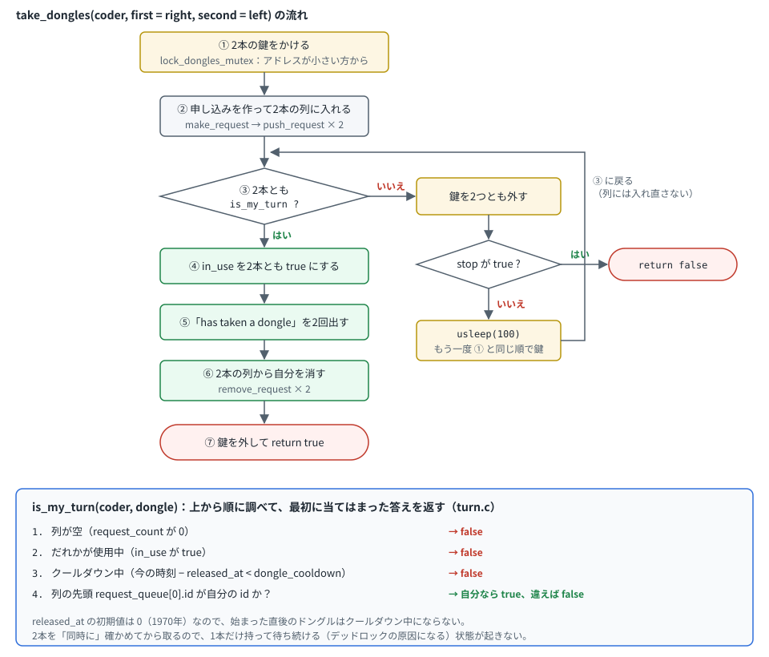
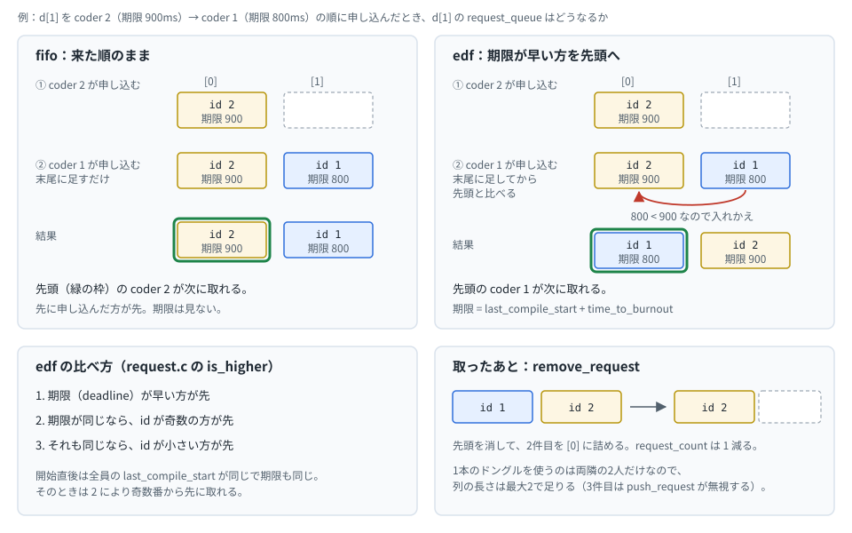

# 03. ドングルの取り合いと fifo / edf

対象ファイル：`codes/threads/dongle.c` `codes/threads/request.c` `codes/threads/turn.c`

この章がプログラムの中心である。考えることは2つ。

- **デッドロック（全員が待ち続けて止まる状態）を起こさない**取り方
- `fifo` / `edf` に従って **次にだれが取るかを決める**しくみ

## 1. 取り方の基本方針

各ドングルは「順番待ちの列」（`request_queue`、最大2件）を持つ。
coder は2本のドングルの列に同時に並び、**2本とも自分が先頭で、2本とも空いている**ときにだけ、2本を同時に取る。

1本だけ先に取って、もう1本を待つことはしない。
全員が「右だけ持って左を待つ」と、だれも先に進めなくなる（デッドロック）からである。

## 2. take_dongles の流れ（dongle.c）



1. `lock_dongles_mutex` で2本の鍵をかける。**アドレス（メモリ上の番地）が小さい方から**かける。
   全員が同じ順で鍵をかけるので、鍵の取り合いでデッドロックしない。
2. `make_request` で申し込み（自分の `id` と燃え尽き期限）を作り、`push_request` で2本の列に入れる。
3. 2本とも `is_my_turn` が `true` になるまで待つ。
   待つ間は鍵を外し、`stop` を確認し、`usleep(100)` してからもう一度鍵をかけて確認する。
   鍵を外さないと、隣の人がドングルを返せなくなる。
4. 取れたら `in_use = true` を2本に設定し、`has taken a dongle` を2回出す。
5. `remove_request` で2本の列から自分を消し、鍵を外して `true` を返す。

申し込みは最初に1回だけ入れる。待っている間も列の中の場所は残っている。

返すとき（`release_dongles`）は1本ずつ鍵をかけ、`in_use = false` と `released_at = 今の時刻` を設定する。

## 3. 自分の番か（turn.c）

`is_my_turn(coder, dongle)` は上から順に調べる。

| 順 | 条件 | 結果 |
|---|---|---|
| 1 | 列が空（`request_count == 0`） | `false` |
| 2 | 使用中（`in_use == true`） | `false` |
| 3 | クールダウン中（今の時刻 − `released_at` < `dongle_cooldown`） | `false` |
| 4 | 列の先頭 `request_queue[0].id` が自分の `id` | `true`（違えば `false`） |

`released_at` の初期値は 0（1970年1月1日）なので、開始直後のドングルはクールダウン中にならない。

## 4. 順番待ちの列（request.c）

`fifo` と `edf` の違いは、**列に入れるときの並べ方だけ**である。取るときはどちらも「先頭の人」が取る。



### make_request

```c
request.id = coder->id;
request.deadline = coder->last_compile_start + config.time_to_burnout;
```

`deadline` は「この時刻までにコンパイルを始めないと燃え尽きる」という時刻（ms）。

### push_request

1. 列がいっぱい（2件）なら何もしない。
2. 末尾に追加し、`request_count` を +1。
3. `edf` のときだけ、追加した申し込みが先頭より優先（`is_higher`）なら入れかえる。

`is_higher` の比べ方：

1. `deadline` が早い方が先
2. 同じなら `id` が奇数の方が先
3. それも同じなら `id` が小さい方が先

開始直後は全員の `last_compile_start` が同じなので、`deadline` も全員同じになる。そのときは 2 により奇数番が先に取れる。

### remove_request

先頭を消し、2件目があれば `[0]` に詰めて、`request_count` を −1 する。

### 列が2件で足りる理由

1本のドングルを使うのは、その両隣の2人だけである。
1人は列に1件しか入れない（取ったら消す）ので、同時に並ぶのは最大2件になる。
