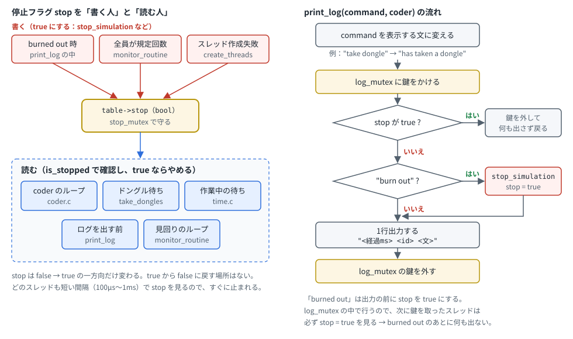
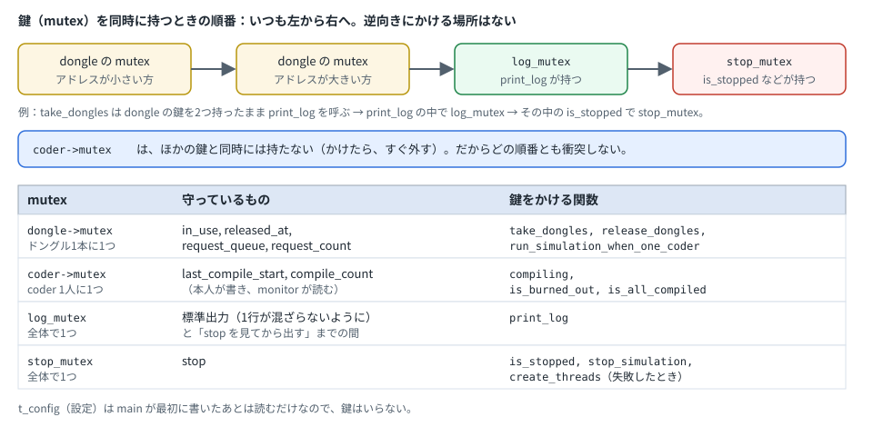

# 04. 停止フラグ・ログ・時間・mutex の順番

対象ファイル：`codes/threads/stop.c` `codes/threads/print_log.c` `codes/threads/time.c`

どれも短いファイルだが、全スレッドから呼ばれるので、まちがえると全体が壊れる。

## 1. 停止フラグ stop（stop.c）

`table->stop` は「全員止まれ」の合図である。`stop_mutex` で守る。

| 関数 | すること |
|---|---|
| `is_stopped(table)` | 鍵をかけて `stop` を読み、`true` / `false` を返す |
| `stop_simulation(table)` | 鍵をかけて `stop = true` にする |



- `stop` を `true` にするのは3か所だけ：燃え尽き（`print_log` の中）、全員が規定回数（`monitor_routine`）、スレッド作成失敗（`create_threads`）。
- `stop` を `false` に戻す場所はない。
- 待つ処理（ドングル待ち・作業中の待ち）はどれも 100µs〜1ms ごとに `is_stopped` を見るので、すぐに止まれる。

## 2. ログ出力（print_log.c）

`print_log(command, coder)` の `command` と出力の対応：

| command | 出力される文 |
|---|---|
| `"take dongle"` | `has taken a dongle` |
| `"compiling"` | `is compiling` |
| `"debugging"` | `is debugging` |
| `"refactoring"` | `is refactoring` |
| `"burn out"` | `burned out` |

流れ：

1. `log_mutex` に鍵をかける（2つのスレッドの出力が1行の中で混ざらないようにする）。
2. `stop` が `true` なら、何も出さずに鍵を外して戻る。
3. `"burn out"` なら、出力する前に `stop_simulation` を呼ぶ。
4. `<経過ms> <id> <文>` を出力する。経過 ms は「今の時刻 − `start_time`」。
5. 鍵を外す。

3 を `log_mutex` の中で行うのが大事である。
次に `log_mutex` を取ったスレッドは必ず `stop == true` を見るので、`burned out` のあとにはだれのログも出ない。

## 3. 時間（time.c）

| 関数 | すること |
|---|---|
| `get_time_ms()` | `gettimeofday` で 1970年からの経過時間を ms で返す（`long long`） |
| `sleep_in_500us_steps(table, ms)` | `ms` ミリ秒たつまで、500µs ずつ待つ。毎回 `stop` を確認し、`true` なら途中で戻る |

`usleep(ms * 1000)` で一度に待たないのは、2つの理由がある。

- 待っている途中で `stop` になっても、すぐに気づけるようにするため。
- `usleep` は指定より長く眠ることがあるので、細かく区切って実際の経過時間で判定するため。

## 4. mutex（鍵）の一覧と、かける順番



| mutex | 個数 | 守るもの |
|---|---|---|
| `dongle->mutex` | N | `in_use` `released_at` `request_queue` `request_count` |
| `coder->mutex` | N | `last_compile_start` `compile_count` |
| `log_mutex` | 1 | 標準出力への1行 |
| `stop_mutex` | 1 | `stop` |

複数の鍵を同時に持つときは、必ず次の順でかける。

```text
dongle の mutex（小さいアドレス） → dongle の mutex（大きいアドレス） → log_mutex → stop_mutex
```

例：`take_dongles` はドングルの鍵を2つ持ったまま `print_log` を呼び、その中で `log_mutex`、さらに `is_stopped` で `stop_mutex` をかける。
逆の順（例：`stop_mutex` を持ったまま `log_mutex` をかける）はどこにもないので、鍵どうしの待ち合いでデッドロックしない。

`coder->mutex` は、ほかの鍵と同時には持たない。かけたらすぐ外す。

`t_config` は main が最初に書いたあと、だれも書きかえないので鍵はいらない。
